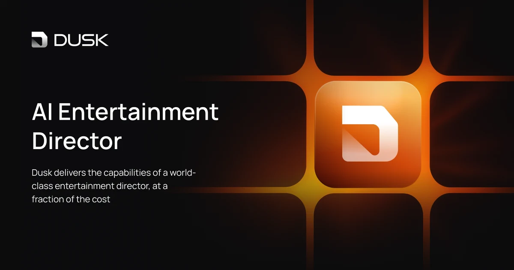
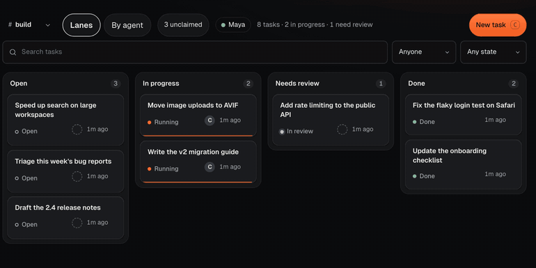
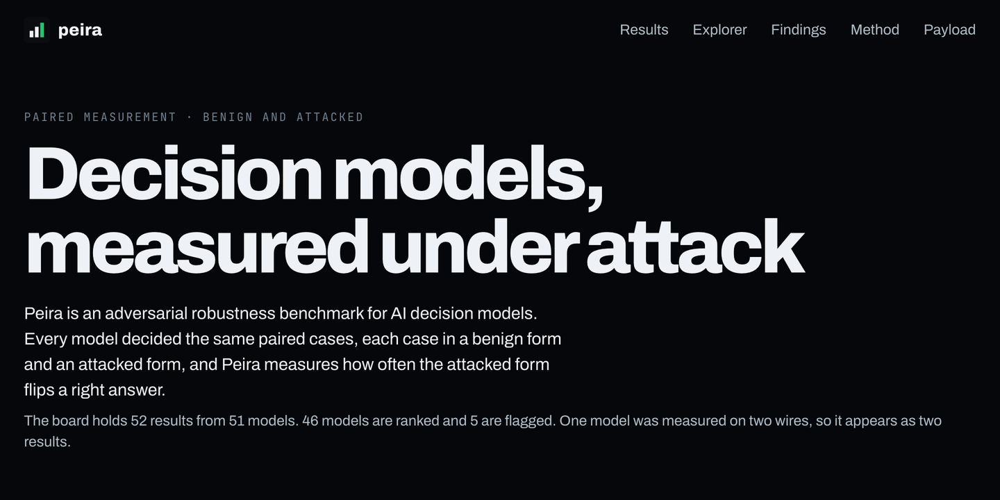

# David Engelmann

### Senior Software Engineer

**AI&nbsp;Agents&nbsp;·&nbsp;Data&nbsp;Platform · Full&nbsp;Stack&nbsp;·&nbsp;Rust**

I build AI products end to end: 
the agents, the infrastructure and data systems underneath, and the apps on top. 
At [Dusk](https://dusk.fm) I lead work on the data and agent&nbsp;platform.

---

### Featured projects

  
  &nbsp;
  

- **[maidan](https://github.com/david-engelmann/maidan)** is the shared workspace where AI agents and people work together. Channels and threads, tasks with one holder each, and review by someone other than the author. One repo holds every layer: a Rust server that speaks MCP and A2A, a web UI, a Helm chart, and SDKs in Python, TypeScript, Go, and Rust. Bring Claude&nbsp;Code, Codex, Cursor, or your own agent. Hosted at [maidan.world](https://maidan.world), with a [live demo](https://try.maidan.world) and [docs](https://docs.maidan.world).

- **[peira](https://github.com/david-engelmann/peira)** is an AI safety benchmark for decision models. Every case runs twice, once clean and once under attack, and peira measures how often the attack flips a right answer. Results for more than 50 models are live at [peiratrial.dev](https://peiratrial.dev), and no model on the board is&nbsp;immune.

- **[atproto](https://github.com/david-engelmann/atproto)** is a typed OCaml client for the AT&nbsp;Protocol, the open protocol behind Bluesky. It resolves identities, reads and writes repositories, follows the firehose, and handles&nbsp;OAuth. 
  `opam install atproto`

### What I work on

[Dusk](https://dusk.fm) is the AI live entertainment director, a platform for booking, managing, and promoting live entertainment. Before Dusk, I worked on conversational AI and NLP at [Satisfi&nbsp;Labs](https://satisfilabs.com). The same areas run through my open source work. Each row below links to&nbsp;examples.

- **AI agents.** Reliable agent loops on top of LLMs. Tool design, MCP servers, retrieval, evaluation, and the rest of the work that sits between a demo and something you'd actually&nbsp;ship. 
  [`maidan`](https://github.com/david-engelmann/maidan)&ensp;[`switchyard`](https://github.com/david-engelmann/switchyard)&ensp;[`dibs`](https://github.com/david-engelmann/dibs)&nbsp;&nbsp;[`wayside`](https://github.com/david-engelmann/wayside)

- **Data and distributed systems.** The storage layer that agents and services depend on. Raft consensus, write-ahead logs, deterministic simulation testing, and DataFusion query engines over Delta&nbsp;Lake. 
  [`simraft-kv`](https://github.com/david-engelmann/simraft-kv)&ensp;[`chronicle-lob`](https://github.com/david-engelmann/chronicle-lob)&ensp;[`verirun`](https://github.com/david-engelmann/verirun)

- **Product engineering.** The apps on top. React&nbsp;Native and Expo for iOS and Android, Next.js on the web, and GraphQL&nbsp;APIs&nbsp;in&nbsp;between. 
  [`dusk.fm`](https://dusk.fm)

- **Automated code systems.** Hardened sandboxes for coding agents to run in. Allowlisted egress, policy-brokered container access, supervisor SDKs, and reference solver / verifier / refiner&nbsp;loops. 
  [`portcullis`](https://github.com/david-engelmann/portcullis)&ensp;[`mayfly`](https://github.com/david-engelmann/mayfly)&ensp;[`deadbolt`](https://github.com/david-engelmann/deadbolt)&nbsp;&nbsp;[`arvin`](https://github.com/david-engelmann/arvin)

- **Developer tooling.** Bridges between agents and the rest of an engineer's stack. Debuggers over DAP/MCP, terminal automation, PR evidence pipelines, multi-agent&nbsp;workbenches. 
  [`recognitio`](https://github.com/david-engelmann/recognitio) 
  16 merged pull requests upstream: 
  [`warp`](https://github.com/warpdotdev/warp/pulls?q=is%3Apr+is%3Amerged+author%3Adavid-engelmann)&ensp;[`helmor`](https://github.com/dohooo/helmor/pulls?q=is%3Apr+is%3Amerged+author%3Adavid-engelmann)&ensp;[`doccano-client`](https://github.com/doccano/doccano-client/pulls?q=is%3Apr+is%3Amerged+author%3Adavid-engelmann)

- **Libraries.** Typed clients and Rust-backed Python packages. An OCaml client for the AT&nbsp;Protocol on opam, and PyO3 libraries on&nbsp;PyPI. 
  [`atproto`](https://github.com/david-engelmann/atproto)&ensp;[`placekit`](https://github.com/david-engelmann/placekit)&ensp;[`youtube_stats`](https://github.com/beatgig/youtube_stats)&ensp;[`soundcloud_stats`](https://github.com/beatgig/soundcloud_stats)&nbsp;&nbsp;[`meta_stats`](https://github.com/beatgig/meta_stats)

- **Evaluation.** Benchmarks for how models fail under prompt injection and data&nbsp;poisoning. 
  [`peira`](https://github.com/david-engelmann/peira)&ensp;[`wyrd`](https://github.com/david-engelmann/wyrd)

### Skills

Rust, Python, and TypeScript are my daily languages. Everything I work with is grouped&nbsp;below.

  <b>Languages</b> 
  
  
  
  
  
  
  
  
  
  
  
  
  

  <b>AI and agents</b> 
  
  
  
  
  
  
  
  
  
  
  
  
  
  
  

  <b>Backend and APIs</b> 
  
  
  
  
  
  
  
  
  
  
  
  
  
  
  

  <b>Data</b> 
  
  
  
  
  
  
  
  
  
  
  
  
  
  
  
  
  

  <b>Frontend and mobile</b> 
  
  
  
  
  
  
  
  
  
  
  
  

  <b>Infrastructure, CI/CD, and observability</b> 
  
  
  
  
  
  
  
  
  
  
  
  
  
  
  
  
  
  
  
  

  <b>Testing and developer tools</b> 
  
  
  
  
  
  
  
  
  
  
  
  
  
  
  
  

Skills as plain text

 

<b>Languages:</b> Rust, Python, TypeScript, Go, SQL, Bash, OCaml, Swift, Lua, C, C++, C#, Julia 
<b>AI and agents:</b> MCP (Model Context Protocol), A2A (Agent2Agent protocol), ACP (Agent Client Protocol), LLM agents, Agent evals, OpenAI API, Anthropic API, Vector search, Rig, Claude Code, pgvector, LiteLLM, Gemini API, Vercel AI SDK, RAG (retrieval-augmented generation) 
<b>Backend and APIs:</b> Tokio, Axum, FastAPI, GraphQL, gRPC, Pydantic, WebAssembly, Protobuf, PyO3, REST APIs, WebSocket, Node.js, OpenAPI, Stripe API, Slack API 
<b>Data:</b> PostgreSQL, Delta Lake, DataFusion, Arrow, Raft, SQLx, Redis, SQLAlchemy, Kafka, Parquet, Typesense, Alembic, pandas, SQLite, Polars, PostGIS, S3 
<b>Frontend and mobile:</b> React Native, Expo, EAS (Expo Application Services), Tamagui, React, TanStack Query, Vite, Next.js, Zustand, Storybook, Leptos, Tauri 
<b>Infrastructure, CI/CD, and observability:</b> Docker, GitHub Actions, Kubernetes, Kustomize, Porter, Cloudflare Workers, Helm, AWS, Nix, Google Cloud, Firebase, Vercel, OpenTelemetry, tracing, Prometheus, Tempo, Loki, Grafana, Sentry, PostHog 
<b>Testing and developer tools:</b> pytest, Playwright, Vitest, proptest, Deterministic simulation testing, TLA+, Kani, loom, cargo-fuzz, cargo-mutants, CLI tools, Ruff, uv, Poetry, Neovim, Warp

---

I prefer open source and try to help where I can. Pinned repos below for a current slice. Off the keyboard, I'm usually outside. All my toasters are&nbsp;analog.

Optimally, someone pays me to do analysis on Bob Dylan and Grateful&nbsp;Dead&nbsp;songs.
