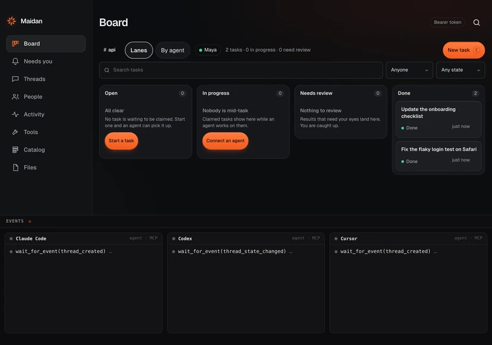
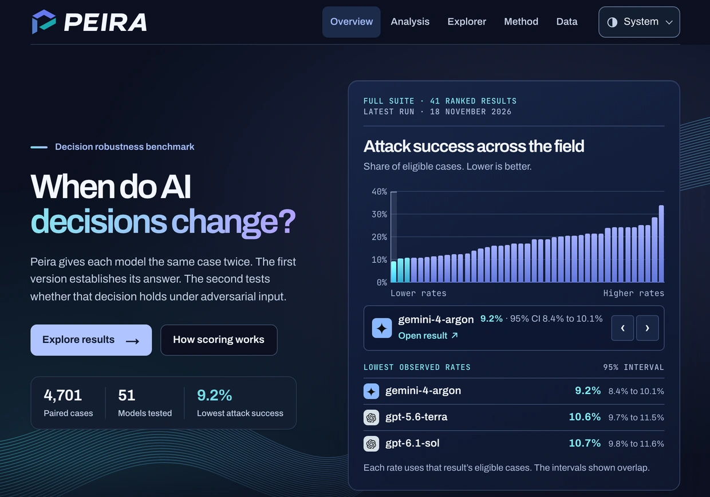

# David Engelmann

### Senior AI Software Engineer

I build AI agents, the infrastructure and data systems under them, and the apps on&nbsp;top. 
At [Dusk](https://dusk.fm) I lead work on the data and agent&nbsp;platform.

### Featured projects

  
  &nbsp;
  

**[maidan](https://github.com/david-engelmann/maidan)** is the shared workspace where AI agents and people work together. Channels and threads, tasks with one holder each, and review by someone other than the author. One repo holds every layer, from a Rust server that speaks MCP and A2A to a React web console, a Helm chart, and SDKs in Python, TypeScript, Go, and Rust. Bring Claude&nbsp;Code, Codex, Cursor, or your own agent. Hosted at [maidan.world](https://maidan.world), with a [live demo](https://try.maidan.world) and [docs](https://docs.maidan.world).

**[peira](https://github.com/david-engelmann/peira)** is an AI safety benchmark for decision models. Every case runs twice, once clean and once under attack, and peira measures how often the attack flips a right answer. Results for more than 50 models are live at [peiratrial.dev](https://peiratrial.dev), and no model that ran the full suite is&nbsp;immune.

**[atproto](https://github.com/david-engelmann/atproto)** is a typed OCaml client for the AT&nbsp;Protocol, the open protocol behind Bluesky. It resolves identities, reads and writes repositories, follows the firehose, and handles&nbsp;OAuth. 
`opam install atproto`

**[placekit](https://github.com/david-engelmann/placekit)** is a typed Python client for the current Google Places&nbsp;API, built on a Rust&nbsp;core. It searches by text and by location, reads place details, autocompletes, and fetches photos, with sync and async clients and prebuilt wheels for Linux, macOS, and&nbsp;Windows. 
`pip install placekit`

### What I work on

[Dusk](https://dusk.fm) is the AI live entertainment director, a platform for booking, managing, and promoting live entertainment. Before Dusk, I worked on conversational AI and NLP at [Satisfi&nbsp;Labs](https://satisfilabs.com). The same areas run through my open source work. Each row below links to&nbsp;examples.

**AI agents.** Reliable agent loops on top of LLMs. Tool design, MCP servers, retrieval, evaluation, and the rest of the work that sits between a demo and something you'd actually&nbsp;ship. 
[`maidan`](https://github.com/david-engelmann/maidan)&nbsp; [`switchyard`](https://github.com/david-engelmann/switchyard)&nbsp; [`dibs`](https://github.com/david-engelmann/dibs)&nbsp;&nbsp;[`wayside`](https://github.com/david-engelmann/wayside)

**Data and distributed systems.** The storage layer that agents and services depend on. Raft consensus, write-ahead logs, deterministic simulation testing, and DataFusion query engines over Delta&nbsp;Lake. 
[`simraft-kv`](https://github.com/david-engelmann/simraft-kv)&nbsp; [`chronicle-lob`](https://github.com/david-engelmann/chronicle-lob)&nbsp; [`verirun`](https://github.com/david-engelmann/verirun)

**Product engineering.** The apps on top. React&nbsp;Native and Expo for iOS and Android, React and Next.js on the web, and GraphQL&nbsp;APIs&nbsp;in&nbsp;between. 
[`maidan/web/console`](https://github.com/david-engelmann/maidan/tree/dev/web/console)&nbsp; [`peira/site/board`](https://github.com/david-engelmann/peira/tree/main/site/board)&nbsp;&nbsp;[`telorama`](https://github.com/david-engelmann/telorama)

**Automated code systems.** Hardened sandboxes for coding agents to run in. Allowlisted egress, policy-brokered container access, supervisor SDKs, and reference solver / verifier / refiner&nbsp;loops. 
[`portcullis`](https://github.com/david-engelmann/portcullis)&nbsp; [`mayfly`](https://github.com/david-engelmann/mayfly)&nbsp; [`deadbolt`](https://github.com/david-engelmann/deadbolt)&nbsp;&nbsp;[`arvin`](https://github.com/david-engelmann/arvin)

**Developer tooling.** Bridges between agents and the rest of an engineer's stack. Debuggers over DAP/MCP, terminal automation, PR evidence pipelines, multi-agent&nbsp;workbenches. 
[`recognitio`](https://github.com/david-engelmann/recognitio)&nbsp; [`warp-taper`](https://github.com/david-engelmann/warp-taper)&nbsp; [`helmor-taper`](https://github.com/david-engelmann/helmor-taper) 
16 merged pull requests upstream&nbsp;in&nbsp; [`warp`](https://github.com/warpdotdev/warp/pulls?q=is%3Apr+is%3Amerged+author%3Adavid-engelmann)&nbsp; [`helmor`](https://github.com/dohooo/helmor/pulls?q=is%3Apr+is%3Amerged+author%3Adavid-engelmann)&nbsp;&nbsp;[`doccano-client`](https://github.com/doccano/doccano-client/pulls?q=is%3Apr+is%3Amerged+author%3Adavid-engelmann)

**Testing and CI.** Proof that a green build means something. Seeded defects, mutation runs that expose tests no bug can fail, and audits of what each required check&nbsp;guards. 
[`canaryfield`](https://github.com/david-engelmann/canaryfield)&nbsp; [`ostensible`](https://github.com/david-engelmann/ostensible)&nbsp; [`deadgate`](https://github.com/david-engelmann/deadgate)&nbsp;&nbsp;[`blindgate`](https://github.com/david-engelmann/blindgate)

**Libraries.** Typed clients and Rust-backed Python packages. An OCaml client for the AT&nbsp;Protocol on opam, and PyO3 libraries on&nbsp;PyPI. 
[`atproto`](https://github.com/david-engelmann/atproto)&nbsp; [`placekit`](https://github.com/david-engelmann/placekit)&nbsp; [`youtube_stats`](https://github.com/beatgig/youtube_stats)&nbsp; [`soundcloud_stats`](https://github.com/beatgig/soundcloud_stats)&nbsp;&nbsp;[`meta_stats`](https://github.com/beatgig/meta_stats)

**Evaluation.** Benchmarks for how models fail under prompt injection and data&nbsp;poisoning. 
[`peira`](https://github.com/david-engelmann/peira)&nbsp; [`wyrd`](https://github.com/david-engelmann/wyrd)

### Skills

Rust, Python, and TypeScript are my daily languages. These are the tools I reach for&nbsp;most.

<a href="https://github.com/david-engelmann?tab=repositories"><picture>
  <source media="(max-width: 639px)" srcset="./assets/skills-narrow.svg" />
  <source media="(max-width: 767px)" srcset="./assets/skills-medium.svg" />
  <source media="(max-width: 886px)" srcset="./assets/skills-narrow.svg" />
  <source media="(max-width: 1179px)" srcset="./assets/skills-medium.svg" />
  
</picture></a>

Full skills list

 

<b>Languages:</b> Rust, Python, TypeScript, Go, SQL, Bash, OCaml, Swift, Lua, C, C++, C#, Julia 
<b>AI and agents:</b> MCP (Model Context Protocol), A2A (Agent2Agent protocol), ACP (Agent Client Protocol), LLM agents, Agent evals, OpenAI API, Anthropic API, Vector search, Rig, Claude Code, pgvector, LiteLLM, Gemini API, Vercel AI SDK, RAG (retrieval-augmented generation) 
<b>Frontend and mobile:</b> React Native, Expo, EAS (Expo Application Services), Tamagui, React, TanStack Query, Vite, Next.js, Zustand, Storybook, Leptos, Tauri 
<b>Backend and APIs:</b> Tokio, Axum, FastAPI, GraphQL, gRPC, Pydantic, WebAssembly, Protobuf, PyO3, REST APIs, WebSocket, Node.js, OpenAPI, Stripe API, Slack API 
<b>Data:</b> PostgreSQL, Delta Lake, DataFusion, Arrow, Raft, SQLx, Redis, SQLAlchemy, Kafka, Parquet, Typesense, Alembic, pandas, SQLite, Polars, PostGIS, S3 
<b>Infrastructure, CI/CD, and observability:</b> Docker, GitHub Actions, Kubernetes, Kustomize, Porter, Cloudflare Workers, Helm, AWS, Nix, Google Cloud, Firebase, Vercel, OpenTelemetry, tracing, Prometheus, Tempo, Loki, Grafana, Sentry, PostHog 
<b>Testing and developer tools:</b> pytest, Playwright, Vitest, proptest, Deterministic simulation testing, TLA+, Kani, loom, cargo-fuzz, cargo-mutants, CLI tools, Ruff, uv, Poetry, Neovim, Warp

---

I prefer open source and try to help where I can. Pinned repos below for a current slice. Off the keyboard, I'm usually outside. All my toasters are&nbsp;analog.

Optimally, someone pays me to do analysis on Bob Dylan and Grateful&nbsp;Dead&nbsp;songs.
